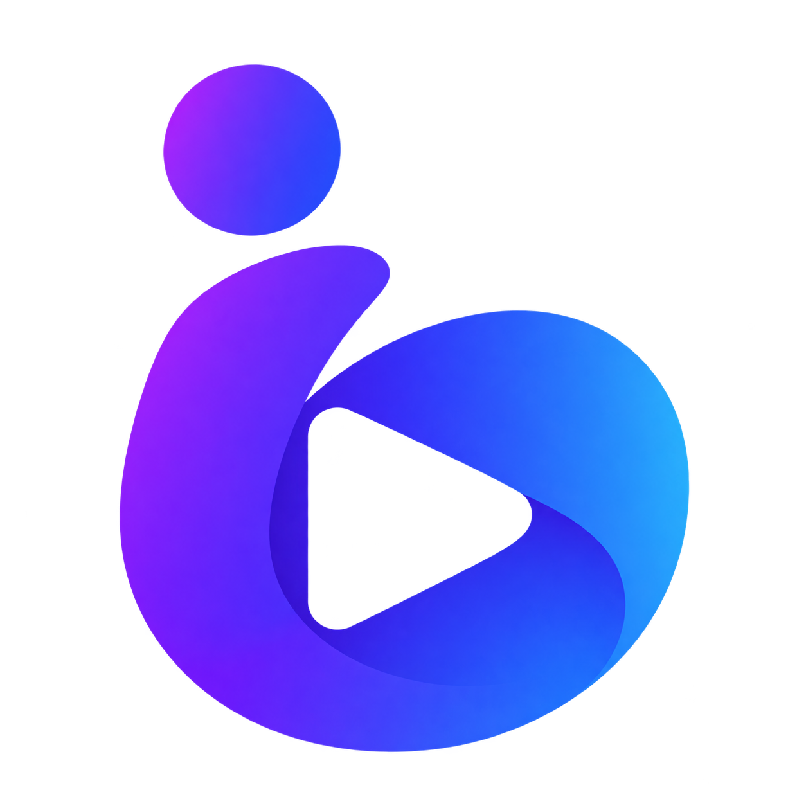

# Isko Tizen — a browser for Samsung Smart TVs



**Browse the web from your couch, using your TV remote.**

[](LICENSE)
[](docs/install.md)
[](docs/roadmap.md)

Isko is an open-source **Samsung Smart TV web browser** built in **C# / .NET**
with **Tizen NUI WebView**. It pairs a native browser shell and remote-controlled
cursor with the website's own player. The goal is responsive navigation and
stable, long viewing sessions on a TV.

[Install on your TV](docs/install.md) · [Roadmap](docs/roadmap.md) ·
[Contribute](CONTRIBUTING.md) · [Report a bug](https://github.com/DewXIT/isko-tizen/issues/new/choose) ·
[Po polsku](docs/README.pl.md)

Source snapshots: [releases](https://github.com/DewXIT/isko-tizen/releases) ·
[changelog](CHANGELOG.md).

## What you can explore

- **Remote-first navigation:** a native pointer, click and edge scrolling, with
  bounded page-input dispatch to keep repeated keys from growing an unbounded queue.
- **TV browser shell:** address/search entry, home tiles, favorites, history and
  an on-demand control bar that leaves room for the page.
- **Website playback:** the original site player, fullscreen hooks and a manual
  video-path option for compatibility investigation.
- **Small protection layer:** popup/navigation policies, a small request blocklist
  and per-session exceptions. Protection is experimental and not comprehensive.
- **Your installation:** build and sign locally using your own TV configuration.
  The normal package has no remote-control server or runtime inspector enabled.

## Project status

**Early alpha for developers and curious TV owners.** Source builds and portable
checks pass; native compatibility and playback still need device validation.
Audio with a black video/loader is an unresolved compatibility issue. Remote input,
IME submit, cross-origin players, fullscreen and long sessions are active priorities.
The current interface is primarily in Polish; localization contributions are welcome.

Distribution is source-only: bring your own Samsung signing profile and build for
your TV. There is no universal signed installer or promise that every streaming
site works. See the [compatibility analysis](docs/browser-video-analysis.md) and
[verification ledger](docs/testing.md) for the evidence and limits.

## Build and install for your own TV

You need a **Tizen 9 TV**, Node.js, .NET SDK 8 and Samsung's Tizen workload/CLI
supporting `net6.0-tizen9.0`. Create your own Samsung TV signing profile. Follow the
[toolchain and certificate setup](docs/install.md), then:

```sh
git clone https://github.com/DewXIT/isko-tizen.git
cd isko-tizen
mkdir -p .local
cp tools/tv/config.example.json .local/isko-tv.json
# Edit only the local copy: tool paths, your signing profile, optional TV address.
node tools/tv/package.cjs --dry-run
node tools/tv/package.cjs
# Explicitly opt in to connecting, installing and launching:
node tools/tv/package.cjs --install
```

Packaging does not contact a TV without `--install`. Normal output disables the
runtime inspector and debug symbols, remaps source paths and audits package
contents. Private configuration, keys, profiles and output are ignored by Git.
Each installer signs locally; a device-specific signed TPK should remain private.
See [installation](docs/install.md).

## Remote controls

These are the current code mappings; key names and IME behavior can vary by TV.

| Input | Browser behavior |
| --- | --- |
| Arrows | Move shell focus, or move the pointer on a page; scroll at page edges. |
| OK / Enter | Activate the shell item or request a click under the pointer. |
| Back | Close an overlay; on a page, leave HTML fullscreen or go back in history, then show controls with Close selected. |
| Menu / color key | Toggle page controls; on home, open the menu, when the remote provides that key. |

Page clicks are synthetic and cannot grant trusted browser activation. If the
keyboard's Go action does not submit, choose the address suggestion below the field.
Some minimal remotes do not send Menu/color keys. See [known limits](docs/browser-video-analysis.md).

## Local verification

```sh
dotnet build src/Isko.Tv/Isko.Tv.csproj -c Release
dotnet build src/Isko.Tv.Experimental/Isko.Tv.Experimental.csproj -c Release
dotnet run --project tests/Isko.Core.Tests -c Release -- src/Isko.Tv/bin/Release/net6.0/Isko.Tv.dll
dotnet run --project tests/Isko.Protection.Tests -c Release
node tests/page-scripts.test.js
node tests/packaging.test.cjs
node tests/diagnostics.test.js
node tools/check-public-data.cjs
node tools/fixture-server/test-handlers.js
```

These checks do not run the native application or prove video playback. The
`net6.0` target is reference compilation only. Samsung's device target and SDK
versions remain separate requirements. Existing .NET 6 support warnings are visible.

## Project layout

- `src/Isko.Tv`: default browser shell and reviewed API12 engine hooks.
- `src/Isko.Core`: view ownership, shell state, cursor and input buffer.
- `src/Isko.Protection`: minimal policy and request-completion adapters.
- `src/Isko.Tv.Experimental`: the same browser sources under a separate Lab app ID.
- `src/Isko.Tv.Legacy`: a separate API11/Tizen 8 prototype, not the default package.
- `src/Isko.Diagnostics`: generic read-only platform-probe source, with no recorded data.
- `tools/fixture-server`: generic controlled pages and original media generation.

Optional fixture servers bind loopback by default. See [fixtures](docs/fixtures.md)
for explicit LAN testing. No test server or remote-control client is bundled into
normal TV packages. A CI workflow is provided as
[an inactive template](tools/ci/verify.example.yml); see [verification](docs/testing.md).

Read [architecture](docs/app.md), [browser/video limits](docs/browser-video-analysis.md),
[engine hooks](docs/experimental-engine.md), [API audit](docs/nui-api12.md),
[protection](docs/protection.md) and [third-party notices](THIRD_PARTY_NOTICES.md).

## Get involved

Help is welcome with remote navigation, video/compositing investigation, performance
measurement, localization and setup docs. Start with the [roadmap](docs/roadmap.md)
and [contribution guide](CONTRIBUTING.md). No TV is needed for portable tests or docs.

Use [Issues](https://github.com/DewXIT/isko-tizen/issues/new/choose) for reproducible
bugs and proposals, and the [security policy](SECURITY.md) for private reports.
Keep device identifiers, network addresses and signing material out of reports.
If Isko is useful to you, a star helps others discover it; watch releases for updates.

## License

[MIT](LICENSE), with [third-party notices](THIRD_PARTY_NOTICES.md). This is an
independent community project, not an official Samsung product.
